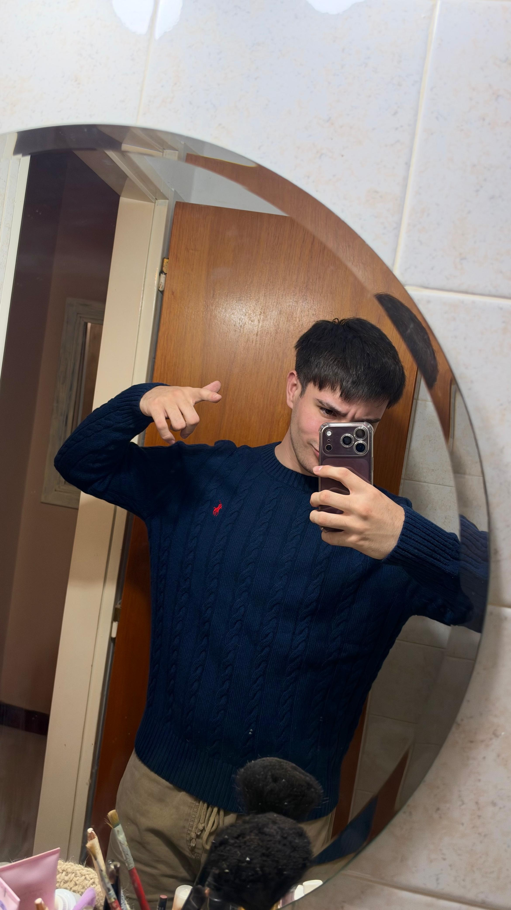

<p align="center">
  
</p>

<h1 align="center">Hola, soy Mati ✦</h1>

<p align="center">
  <strong>Vibecoder · creador de experiencias web</strong><br />
  De una idea a algo que ya podés abrir, usar y compartir.
</p>

<p align="center">
  
  
</p>

---

### `> mi forma de crear`

Me gusta agarrar una idea, probarla rápido y pulirla hasta que se sienta bien. Combino código, diseño y herramientas de IA para construir webs y soluciones útiles.

```text
idea → prototipo → código → detalles → publicar → mejorar
```

### `> proyectos para explorar`

| Proyecto | Qué vas a encontrar |
| :-- | :-- |
| [Gestor](https://github.com/matijaime/gestor) | Seguimiento de gastos con conversión de monedas en tiempo real. |
| [Simple Laprida](https://github.com/matijaime/simple-laprida) | Sitio web para soluciones administrativas en Laprida. |
| [Habitación gamer 360°](https://github.com/matijaime/pagina_web_VR) | Experiencia interactiva creada con HTML, CSS y JavaScript. |

### `> herramientas que uso`

<p>
  
</p>

### `> hablemos`

¿Tenés una idea para construir? [Escribime](mailto:matiasjaime699@gmail.com) o mirá [mis repositorios](https://github.com/matijaime?tab=repositories).

<p align="center"><sub>Siempre creando. Siempre iterando. ✦</sub></p>
